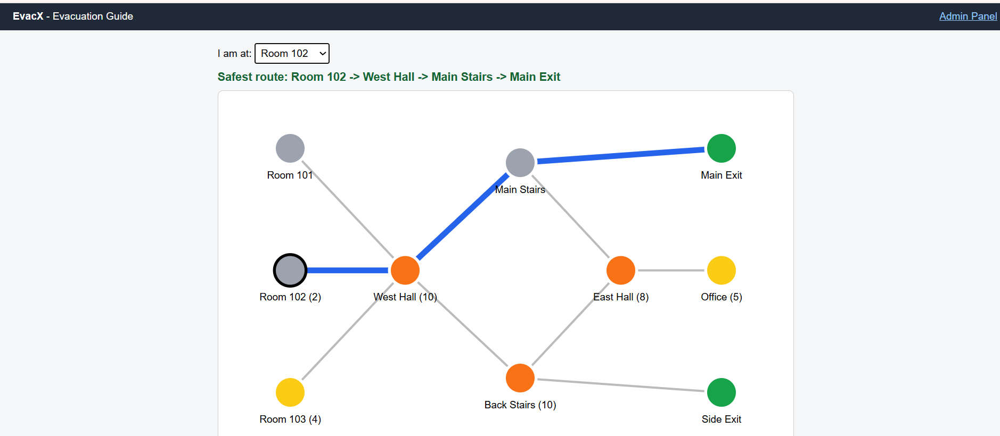
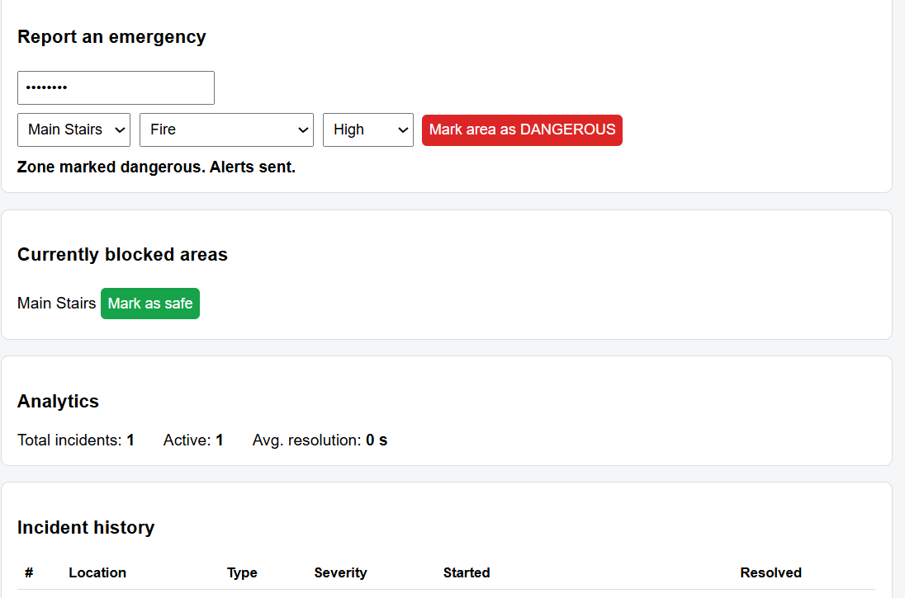
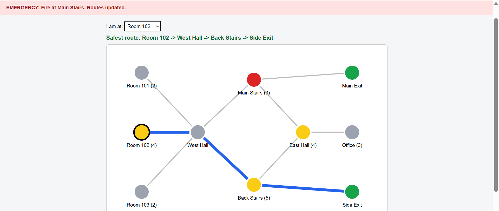

# EvacX: Intelligent Dynamic Evacuation & Emergency Response System

## 1. Introduction
During emergencies such as fires, earthquakes, or gas leaks, people often
don't know the safest way out, and fixed evacuation routes can become unsafe.
EvacX dynamically calculates the safest route based on the location and
severity of an emergency.

## 2. Objectives
- Represent buildings as digital maps with exits and assembly points
- Detect and mark blocked or dangerous areas
- Compute the safest route in real time
- Notify users instantly through live alerts
- Provide an admin panel and incident history

## 3. Key Features
- Building map modelled as a graph (rooms, corridors, stairs, exits)
- Dynamic route calculation using Dijkstra's algorithm with danger and
  congestion penalties
- Real-time alerts via WebSockets
- Admin panel to add or clear emergency zones
- Simulated crowd density
- Emergency history and analytics

## 4. Technologies Used
| Layer | Technology |
|---|---|
| Backend | Go ([chi/gin]) |
| Real-time | WebSockets ([gorilla/websocket]) |
| Database | [PostgreSQL/SQLite] |
| Frontend | [HTML/JS/React], SVG |
| Algorithm | Dijkstra (custom implementation, container/heap) |

## 5. System Design
[Add an architecture diagram: Client -> Go API -> Routing Engine -> Database,
with WebSocket alerts flowing back to clients.]

## 6. Implementation
1. **Graph model:** nodes are locations; edges are walkable paths with a
   cost = distance + danger penalty + congestion penalty.
2. **Routing:** Dijkstra runs from the user's node to all exits and picks
   the lowest-cost one. Blocked nodes are excluded.
3. **Emergency handling:** when an admin marks a zone unsafe, the graph
   updates, routes are recomputed, and an alert is broadcast.
4. **Simulation:** sensors and indoor positioning are simulated through the
   admin panel and a crowd generator. The API is designed so real sensors
   can plug in later.

## 7. Screenshots

## 8. How to Run
git clone [repo link]
cd evacx
go run ./cmd/server
# open http://localhost:8080

## 9. Limitations and Future Work
- Sensor input is simulated
- Future: BLE/Wi-Fi indoor positioning, mobile app, multi-building support

## 10. Author
Japneet Kaur, 2401720015 , Bsc(Hons) Computer Science
